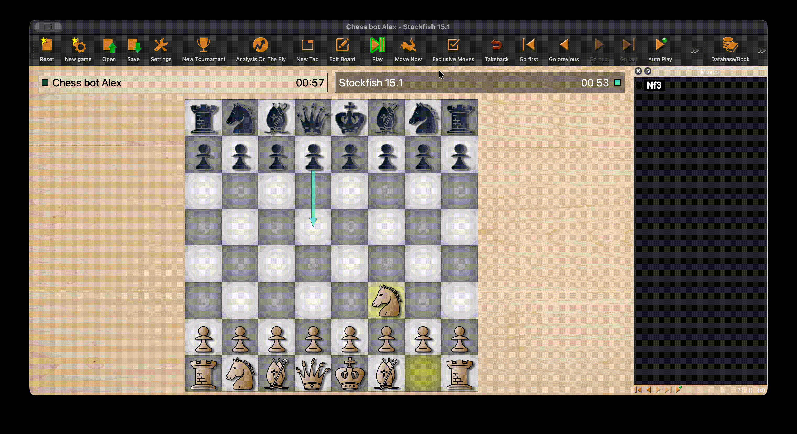

# alex-chess-engine

A UCI-compatible chess engine in Python: negamax search with alpha-beta pruning, iterative deepening under a real clock, quiescence search, and a transposition table - built to learn how chess engines work. About 500 lines, so it reads in one sitting.



## How it thinks

One move decision flows through five layers, each solving a specific failure mode of the one before it:

```
time budget → iterative deepening → negamax + alpha-beta → move ordering → quiescence → evaluation
                                          ↕ transposition table
```

**Iterative deepening + deadline time management** (`choose_move_timed`, `pick_time_limit`).
The engine searches to depth 1, then 2, then 3… instead of committing to a single deep search. Why: on a clock you never know in advance how long depth N will take. Deepening incrementally guarantees a fully-searched best move is always in hand when time expires. The per-move budget under UCI time controls is `remaining/30 + increment/2`, capped at 25% of the remaining clock; the search hard-stops at 97% of that budget via a deadline check inside the tree (a `TimeoutError` unwinds the recursion, and the half-finished iteration is discarded in favor of the last completed one).

**Negamax with alpha-beta pruning** (`negamax`).
Negamax is minimax collapsed into a single recursive function: every node scores the position from the side-to-move's perspective and negates the child's result. Why: one code path instead of mirrored min/max logic - fewer places for sign bugs. Alpha-beta maintains a window of scores that can still matter and cuts off any branch proven irrelevant to the final choice, which is what makes depth 3-4 reachable in pure Python at all.

**Move ordering** (`ordered_moves`, `_capture_moves`).
Alpha-beta only prunes well when strong moves are tried early - the sooner a good move raises alpha, the more of the remaining tree gets cut. So the main search tries the transposition table's remembered best move first, then captures and checks ahead of quiet moves. Inside quiescence, captures are sorted by MVV-LVA (most valuable victim, least valuable attacker): winning a queen with a pawn is examined before winning a pawn with a queen.

**Quiescence search** (`quiescence`).
At depth 0 the engine does not evaluate immediately - it keeps searching captures (up to 8 extra plies) until the position is quiet. Why: the horizon effect. A fixed-depth search that stops mid-exchange - right after QxP, one ply before the pawn recaptures the queen - reports a fantasy score. Quiescence makes leaf evaluations tactically stable.

**Transposition table** (`TT`, `tt_key`).
A dictionary keyed on the first four FEN fields (piece placement, side to move, castling rights, en passant square), storing depth, score, a bound flag (`EXACT`/`LOWER`/`UPPER`), and the best move found. Why: the same position is reached through many move orders, and iterative deepening revisits every position at each new depth. Cached results skip re-search, and the stored best move seeds move ordering on the next visit. FEN keys were a deliberate trade: slower than Zobrist hashing, but trivially correct and debuggable.

**Evaluation** (`engine/evaluation.py`).
Material count plus piece-square tables (mirrored for Black), with terminal handling for checkmate, stalemate, and insufficient material, and a small penalty for repetition. Intentionally simple - this project is about the search.

## Measured behavior

- Iterative deepening runs depth 1→6 (capped at 6, which it does not reach in practice); fixed-depth mode defaults to depth 3.
- Midgame positions complete depth 3 in about 0.7-2 s and depth 4 in 4-14 s on an M2 (iterative deepening from a cold transposition table, five midgame positions). Within a 0.5-1.5 s move budget the timed search reaches depth 2-3.
- The demo above is the engine playing Stockfish 15.1 in Banksia on a 1-minute clock.
- I haven't measured its Elo: the engine has no opening book, no endgame tables, and a material-plus-PST evaluation. It plays coherent, tactical chess; it will not beat Stockfish.

## Running it

```bash
git clone https://github.com/alxlyn/alex-chess-engine.git
cd alex-chess-engine
python3 -m venv .venv && source .venv/bin/activate
pip install -r requirements.txt
```

**In a chess GUI (Banksia or any UCI GUI):** add a new UCI engine, set the command to the venv's Python and the argument to `uci.py`:

```
Command:   /path/to/alex-chess-engine/.venv/bin/python
Argument:  /path/to/alex-chess-engine/uci.py
```

The engine answers the standard handshake (`uci`, `isready`, `ucinewgame`, `position startpos|fen … moves …`) and supports `go depth N`, `go movetime <ms>`, and clock mode `go wtime/btime [winc/binc]` - time mode takes precedence over depth.

**From the terminal:**

```bash
python uci.py     # raw UCI loop on stdin/stdout - type the commands yourself
python main.py    # self-play harness: the engine plays itself and prints each move
```

## Project layout

```
engine/
  search.py      # negamax, alpha-beta, quiescence, move ordering, TT, iterative deepening
  evaluation.py  # material + piece-square tables
uci.py           # UCI protocol loop and time-control parsing
main.py          # self-play harness
```

## Requirements

- Python 3.10+ (uses modern type syntax)
- [python-chess](https://python-chess.readthedocs.io/) - board representation, legal move generation, FEN handling (see `requirements.txt`)

Search, evaluation, move ordering and the UCI layer live in this repo; python-chess supplies board representation and legal move generation.
